# templator : guide d'utilisation

_templator_ (« Moteur de templates ») permet de créer des templates supplémentaires pour votre blog, par copie de ceux du thème, puis de les attribuer à un billet, à une page, à une catégorie ou à un widget.

## Sommaire

1. [Avant de commencer](#avant-de-commencer)
2. [Le menu du plugin](#le-menu-du-plugin)
3. [Créer un template](#créer-un-template)
4. [Modifier un template](#modifier-un-template)
5. [Copier ou supprimer un template](#copier-ou-supprimer-un-template)
6. [Attribuer un template à un billet](#attribuer-un-template-à-un-billet)
7. [Templates utilisés](#templates-utilisés)
8. [Template de catégorie](#template-de-catégorie)
9. [Template de widget](#template-de-widget)

## Avant de commencer

Les templates sont enregistrés dans le dossier `public/other-templates` de votre blog, qui doit être accessible en écriture. Le réglage système `media_exclusion` ne doit plus contenir `html` (dans **Système › about:config › system › media_exclusion**), sinon les fichiers `.html` ne sont pas listés.

## Le menu du plugin

Le menu **Plugins › Moteur de templates** ouvre la page d'accueil du plugin, avec trois liens : **Templates disponibles**, **Templates utilisés** et **Nouveau template**.

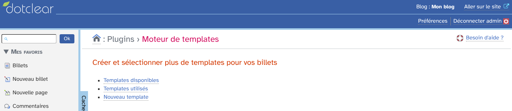

## Créer un template

Cliquez sur **Nouveau template**. Le premier champ (intitulé **Titre**) choisit le modèle de départ : **Template vide**, `post.html`, `page.html` (avec le plugin Pages) ou `category.html` (si le blog a des catégories). Saisissez ensuite le **Nom de fichier**, sans `.html`.

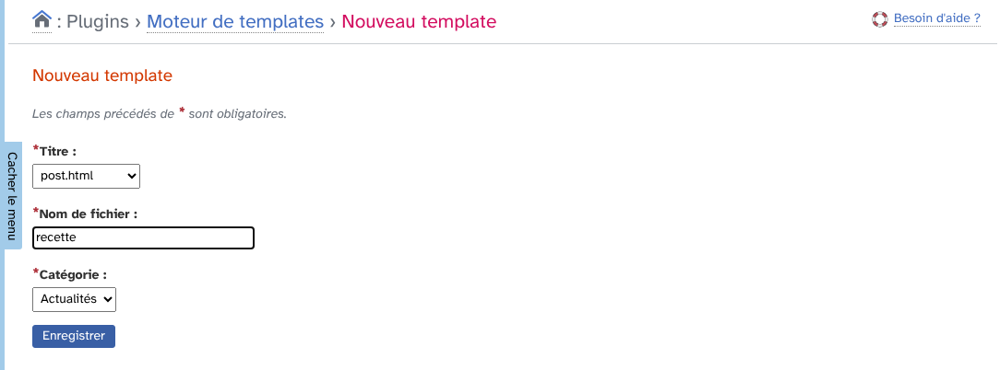

Pour un modèle `category.html`, choisissez plutôt la **Catégorie** : le fichier est nommé `category-<numéro>.html` et s'applique à cette catégorie.

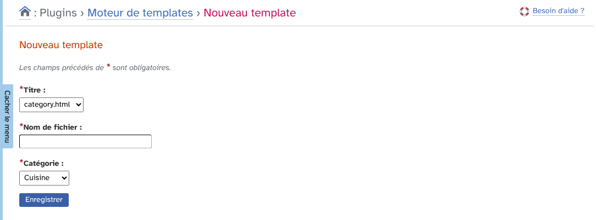

Cliquez sur **Enregistrer** : le template est créé.

## Modifier un template

**Templates disponibles** liste les templates créés. Chaque fiche affiche le nom, le nombre de billets qui l'utilisent, la date et la taille. Cliquez sur le nom pour le modifier.

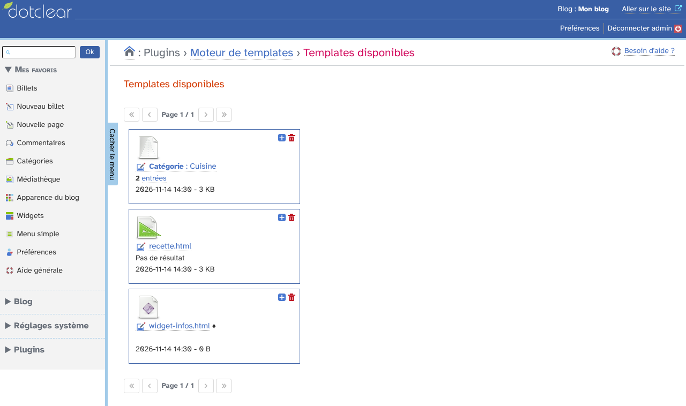

L'éditeur utilise la coloration syntaxique de Dotclear si elle est activée dans vos préférences. Modifiez le code puis cliquez sur **Enregistrer**.

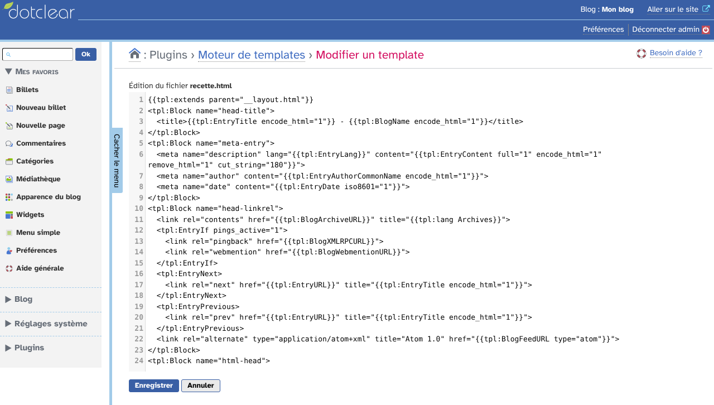

## Copier ou supprimer un template

Sur la fiche d'un template, l'icône **+** bleue le copie sous un nouveau nom.

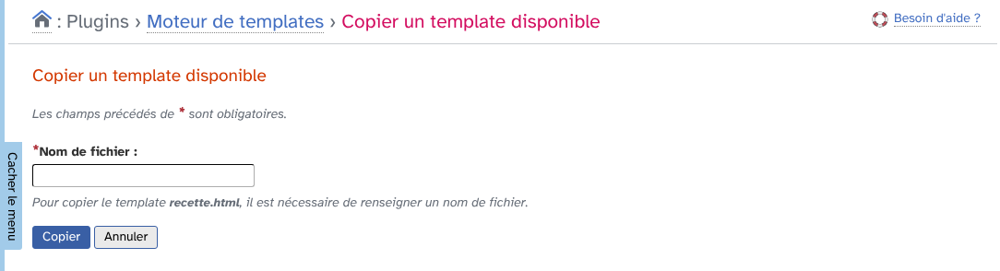

L'icône rouge le supprime, après confirmation.

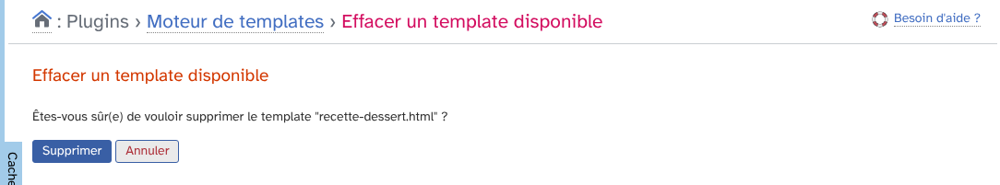

## Attribuer un template à un billet

Sur la page d'édition d'un billet, la section **Template** de la colonne de droite propose la liste des templates. Choisissez-en un puis enregistrez le billet. Sur le blog, le billet utilise alors ce template.

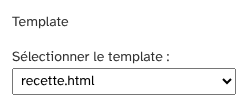

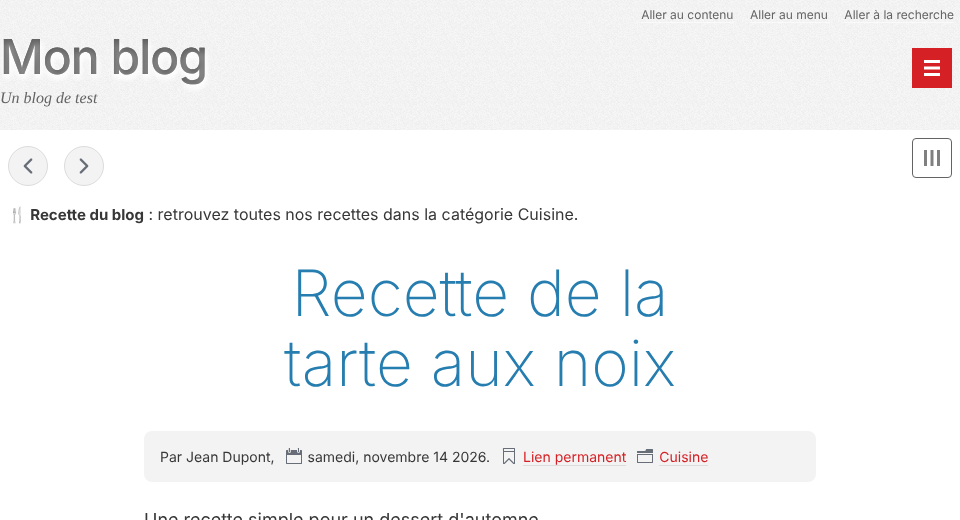

Le choix **Aucun template additionnel** rend au billet le template du thème.

## Templates utilisés

**Templates utilisés** liste les templates attribués à au moins un billet, avec leur nombre d'entrées.

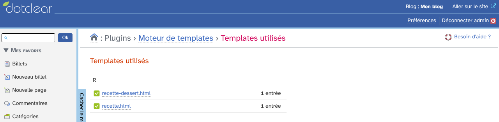

Cliquez sur un template pour afficher les billets concernés. Cochez-les puis **Désélectionner ce template pour la sélection de billets** pour leur retirer le template.

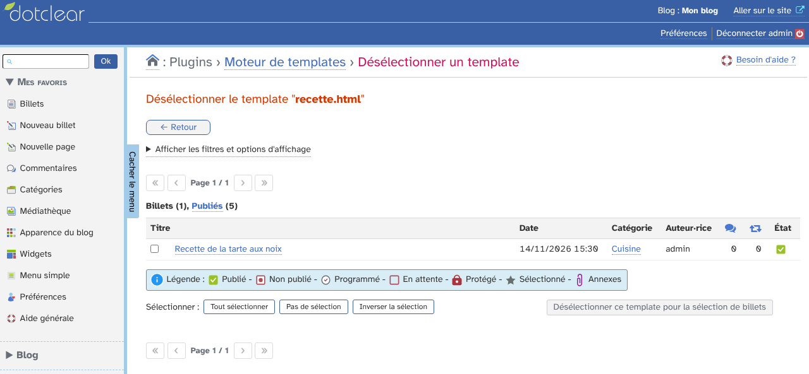

## Template de catégorie

Un template `category-<numéro>.html` est utilisé automatiquement pour la page de cette catégorie, sans rien attribuer.

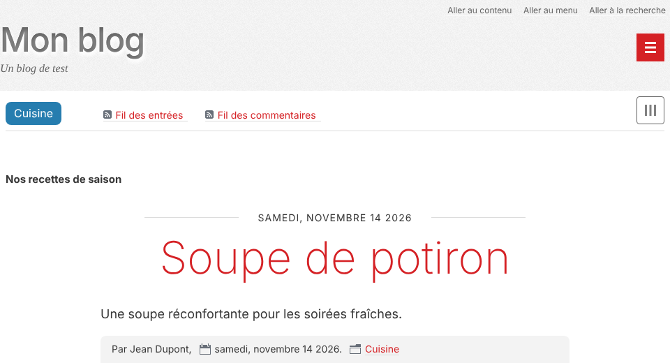

## Template de widget

Un template dont le nom commence par `widget-` (par exemple `widget-infos.html`) peut être affiché dans un widget. Dans **Apparence du blog › Widgets**, ajoutez le widget **Templator › Rendering** à un volet et choisissez le template.

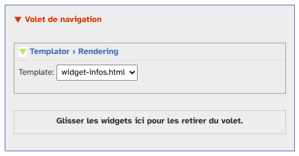

Le contenu du template s'affiche dans le volet.

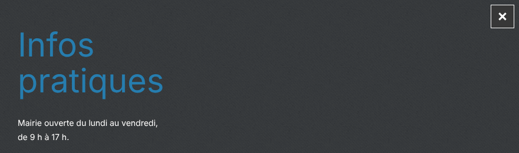
